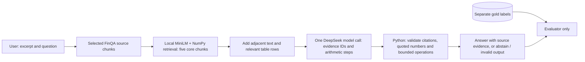

# Product overview: FinQA Evidence QA

## User, input and output

**Persona:** a junior financial analyst who must check a numerical claim in a report excerpt and needs to see the source figures and calculation. This is a research demo for a reviewer, not investment advice or a production filing-search system. The user chooses one of ten development FinQA report excerpts and enters a numerical question. The system sees only that excerpt's text and table chunks. It does not accept a PDF upload or search across reports.

An answer contains the computed number, unit or signed percentage, evidence IDs and source text, operand values, arithmetic steps, latency and reported API cost. When no evidence is retrieved or the model says the evidence is insufficient, it abstains. If a proposed number, quote, citation or arithmetic step fails validation, it reports an invalid output rather than presenting a fabricated answer. Citation IDs and exact quotes are structural checks, not proof that the cited year, row or formula answers the question; the evaluation includes manual review.

## Architecture

Full-context comparison sends all chunks from the same selected excerpt to the same model and calculator. Keyword/BM25 mode retrieves evidence without a model answer. OpenSearch is an optional backend; the reported runs use local retrieval.

## Target and observed results

The main target was **14/20** numerically correct answers using the original FinQA `exe_ans`. Accuracy is separate from latency. Abstentions and failures count incorrect; percentage-point and numeric tolerance rules are in the [evaluation policy](../eval/scoring_rules.md).

| Test of the same 20 public cases | First full context | First RAG | Iterated full context | Iterated RAG |
|---|---:|---:|---:|---:|
| Correct `exe_ans` | 12/20 | 8/20 | 17/20 | 16/20 |
| All labelled evidence found | 20/20 | 13/20 | 20/20 | 17/20 |
| Median per-question latency | 4.75 s | 3.42 s | 3.96 s | 4.15 s |
| Completed within 30 s | 20/20 | 20/20 | 20/20 | 20/20 |
| Reported API cost for run | $0.022575 | $0.013403 | $0.018767 | $0.015483 |

The iterated RAG result exceeds the numeric target on these cases but trails full context by one answer. It uses fewer input tokens and lower reported API cost than iterated full context, although its median latency is slightly higher. Its 17/20 all-gold coverage includes the context expansion around five core retrieved chunks. Neither result includes local compute, model download, or index preparation in API cost and timed per-question latency. The 20 public test cases were inspected to diagnose the first run before the second run; therefore, the second result is **within-set development evidence**, not an unbiased estimate of performance on unseen questions. With 20 cases, one answer changes accuracy by five percentage points. The [archived per-case records and citation review](../eval/README.md) document unresolved label/interpretation disputes without changing `exe_ans` scores.
